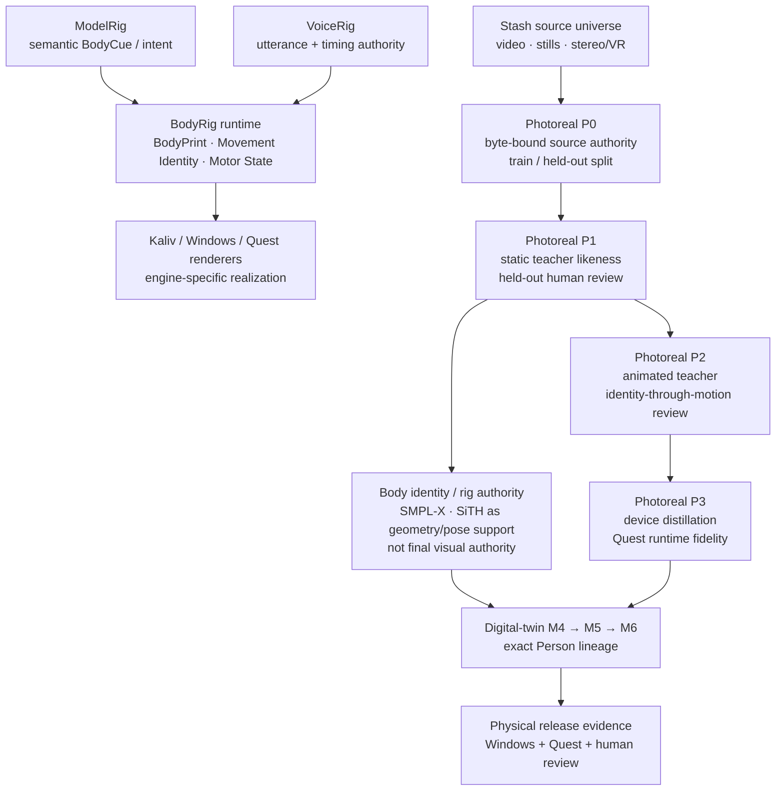

# BodyRig

_Documentation baseline: 2026-11-11 · Photoreal V2 / V1 physical-convergence baseline._

BodyRig giver ModelRig en visuel og kropslig tilstedeværelse.

- **ModelRig** tænker og producerer semantisk intent.
- **VoiceRig** bygger `.mrvoice`-stemmeprofiler og ejer TTS (taler). Tale-til-tekst (lytte) ligger i dag i ModelRig, ikke i VoiceRig.
- **BodyRig** er autoritet for body identity, `.mrbody`, BodyPrint, source-derived Movement Identity og Motor State.
- **Kaliv / VR-klienter** renderer den allerede udførte Motor State og må ikke genopfinde krops-/bevægelsesprofilen.

Den aktuelle arkitektur er samlet i **`docs/ARCHITECTURE.md`**. Runtime-kontrakten for BodyCue/Motor State står i **`docs/MOTOR_STATE.md`**. `HANDOFF.md` er den operationelle overgangs-/statusguide og må ikke bruges til at opfinde fysisk eller menneskelig evidens.

## V1-mål

Det normale high-fidelity flow er:

> vælg kildevideo → auditér source-univers og view/detail-sufficiency → isolér den rigtige performer → udled BodyPrint + Movement Identity → rekonstruér visuel identitet/krop → fit source-derived VRM 1.0 → eksportér `.mrbody` → anatomisk skin-QA → materialisér validerede runtime-assets → kør samme faste deformation-sweep på Windows/Quest → bind human review og de samme bytes gennem release-kæden.

V1 er local-first. Kildevideo er build-input og må ikke ende i den portable profil eller support-output. Manglende source evidence er en blokering; BodyRig må ikke udfylde identitet, detalje eller bevægelseskarakteristika med generiske gæt.

## Bootstrap

```bash
python -m venv .venv
. .venv/bin/activate  # Windows: .venv\Scripts\activate
pip install -e ".[test]"
pytest -q
bodyrig
```

`bodyrig` starter Person Studio (web-UI + API, `bodyrig.guided_app`) på `127.0.0.1:8775`.

| Variabel | Standard | Betydning |
|---|---|---|
| `BODYRIG_HOST` | `127.0.0.1` | Bind-adresse. Andet end `127.0.0.1`, `localhost` eller `::1` afvises ved start, medmindre `BODYRIG_ALLOW_REMOTE=1`. |
| `BODYRIG_PORT` | `8775` | Port. |
| `BODYRIG_ALLOW_REMOTE` | (ikke sat) | Kun `1` tillader ikke-loopback bind og ikke-loopback requests; ellers svarer servicen `403` til andre end loopback. |

`pyproject.toml` har bevidst brede versionsintervaller. De eksakte installationer ligger i `requirements/` (se `docs/DEPENDENCY_AUTHORITY.md`):

- `requirements/windows-python.lock.txt` — riggen/operatøren (CPython 3.11): `pip install -c requirements/windows-python.lock.txt -e ".[test]"`;
- `requirements/linux-ci-python.lock.txt` — Linux-CI: `pip install -c requirements/linux-ci-python.lock.txt -e ".[test]"`;
- `requirements/blender-bpy.lock.txt` — hash-låst `bpy` til scene inspector og VRM-eksport, i sin egen Python 3.11-venv (`--require-hashes --no-deps`), aldrig i BodyRig-miljøet.

På Windows-riggen startes Person Studio med `.\start-windows.ps1`, som kræver repoets `.venv`, et clean checkout og at `.venv` importerer `bodyrig` fra netop dette checkout (se `docs/PERSON_UI.md`).

## Klargør målriggen

Recovery-, PHALP-, SiTH-, OpenPose- og modelafhængigheder holdes uden for BodyRigs portable runtime. Den samlede Windows-klargøring er:

```powershell
.\setup-rig-windows.ps1 `
  -SmplModelPath "C:\Downloads\basicModel_neutral_lbs_10_207_0_v1.0.0.pkl"
```

Setup er fail-closed og producerer et lokalt `bodyrig-rig-setup`-bevis. BodyRig downloader eller redistribuerer ikke licensbelagte SMPL/SMPL-X-assets på brugerens vegne; nødvendige assets skal være lovligt anskaffet separat.

Recovery alene kan stadig diagnosticeres direkte. Den pinned PHALP-checkout er obligatorisk i preflighten:

```powershell
bodyrig-recovery-preflight `
  --python "C:\path\to\4dh-python.exe" `
  --repo "C:\path\to\4D-Humans" `
  --phalp-repo "C:\path\to\PHALP" `
  --out ".\bodyrig-recovery-preflight.json"
```

Den ældre `run-physical-gate.ps1` / `validate-rig.ps1`-vej er fortsat nyttig til recovery- og procedural-VRM-diagnostik, men en procedural placeholder er **ikke** længere produktions-Gate A og kan ikke ende i `production_activation=true`.

## Canonical fysisk high-fidelity clone

Når målriggen er klar, køres den rigtige Stash → recovery → visual identity → SiTH/SMPL-X → VRM-kæde med:

```powershell
.\clone-body-from-stash-ready.ps1 `
  -PerformerId 123 `
  -BodyId "performer-123"
```

Launcheren binder kørselen til den eksakte BodyRig Git-revision, kræver clean checkout som standard, kører en frisk live-readiness, binder readiness-SHA-256 til sessionen og nægter PASS, hvis Git HEAD ændrer sig under den lange clone.

Standard-output skrives uden for repoet under `%LOCALAPPDATA%\BodyRig\physical-clones`; session/readiness-evidence skrives under `%LOCALAPPDATA%\BodyRig\physical-clone-sessions`. Det forhindrer genererede clone-artifacts i selv at gøre checkout dirty.

En PASS-session er endnu ikke produktionsacceptance. Den skal promoveres uden at bygge avataren igen:

```powershell
.\accept-physical-clone.ps1 `
  -SessionReport "C:\Users\you\AppData\Local\BodyRig\physical-clone-sessions\performer-123-....json"
```

Denne Gate A-bro kræver bl.a.:

- samme eksakte, clean BodyRig-revision som clone-sessionen;
- uændret readiness/session-evidence;
- recovery-proof og package med identisk BodyPrint/source count/recovery provenance;
- visual-identity provenance bundet til identity-profile;
- built-in `sith-smplx-vrm` revision `1`;
- VRM 1.0 og `placeholder_avatar=false`;
- source-derived shape/motion;
- strukturelt gyldige skin weights;
- en create-only anatomisk skin-QA bundet til package- og avatar-SHA;
- runtime materialiseret fra den **samme** accepterede `.mrbody`.

Gate A binder også Python-koden til samme checkout. Den valgte `BodyRigPython` — som default repoets `.venv\Scripts\python.exe`, ellers en eksplicit/fundet interpreter — skal kunne importere `bodyrig`, og `bodyrig.__file__` skal resolve til netop `<checkout>\bodyrig\__init__.py`. En global wheel eller et andet checkout afvises derfor, selv hvis selve PowerShell-scriptet ligger på den korrekte Git-revision.

Gate A-bundlen indeholder den accepterede `.mrbody`, `bodyrig-skin-qa.json`, runtime-manifest/payloads samt kopier af physical-clone session- og readiness-evidence. Skin-QA klassificerer cross-region weight leakage som `low-risk`, `review` eller `high-risk`, men markerer altid `manual_review_required=true`; den erstatter altså ikke den fysiske deformationstest. Gate A efterlader fortsat `physical_renderer_acceptance=pending` og `production_activation=false`.

Se `docs/SKIN_QA.md` for metode, thresholds og trust boundary.

## Genoptag fysisk acceptance sikkert

Fysisk acceptance kan strække sig over flere sessioner og maskiner. Brug den read-only status checker i stedet for at gætte, hvilket trin der mangler:

```powershell
.\physical-acceptance-status.ps1 `
  -SessionReport "C:\path\to\bodyrig-physical-clone-session.json"
```

Når Gate A allerede findes:

```powershell
.\physical-acceptance-status.ps1 `
  -AcceptanceDir "C:\acceptance"
```

CLI-varianten er:

```powershell
bodyrig-acceptance-status --acceptance-dir "C:\acceptance"
```

En normal wheel-installation kan altid bruges til **read-only inspection**, fordi wheel'en indeholder den samme byte-identiske `reference-renderer/renderer-contract.json`. Men site-packages er ikke et BodyRig Git-checkout og må derfor ikke bruges som authority for fysiske operator-kommandoer. Hvis status-CLI'en ikke kan auto-detektere et checkout med den komplette canonical operator dependency closure, viser den status men sætter `next_command=null` og markerer resultatet `Inspection-only`.

Hvis CLI'en køres fra en separat installation, kan et rigtigt checkout bindes eksplicit:

```powershell
bodyrig-acceptance-status `
  --acceptance-dir "C:\acceptance" `
  --operator-root "C:\Users\you\Desktop\BodyRig"
```

Før en executable next-command vises, verificerer statuslaget at operator-root er et Git-checkout med hele den nødvendige closure: reference-wrappers, de underliggende Windows/Quest/attestation/release-scripts, `renderer-contract.json`, renderer-build-scriptet samt Unity `ProjectVersion.txt` og `Packages/manifest.json`. Et sparse checkout er derfor kun acceptabelt, hvis alle disse filer faktisk er materialiseret. Derefter skal `git rev-parse HEAD` matche acceptance-revisionen, og `git status --porcelain` skal være clean. Forkert revision eller dirty checkout bliver `BLOCKED` med exit code `3`; manglende operator-dependencies eller malformed/tampered evidence er `ERROR` med exit code `2`. Når checkoutet er validt, vises next-command med en absolut script-path, så den ikke afhænger af current working directory.

Status-checkeren **muterer ingen evidence**. Den læser og re-hasher den eksisterende kæde og returnerer det præcise næste gate/kommando, når en gyldig operator-authority er tilgængelig:

`Gate A → runtime visual authority (Gate A.5: Photoreal P3 human PASS) → Windows probe → Windows human attestation → Quest probe → Quest human attestation → final release`.

Hvis evidence er inkonsistent — fx et ufuldstændigt machine/deformation-par, både nyt og legacy layout, forkert embedded BodyRig build-revision eller en attestation der ikke længere hasher til sine eksakte probe-filer — returnerer den `ERROR` i stedet for at foreslå et næste trin. Complete legacy root-par kan stadig inspiceres for backward compatibility, men den canonical V1 release-policy kræver de nye contract-bound evidence-directories. `-Json` / `--json` kan bruges til maskinlæsbar status.

## `.mrbody` → renderer-runtime

Renderere må ikke selv udpakke pakken eller vælge en løs VRM. BodyRig materialiserer kun payloads, som allerede har bestået `.mrbody`-valideringen:

```powershell
bodyrig-materialize `
  ".\performer-123.mrbody" `
  --out ".\runtime"
```

`runtime/runtime-manifest.json` indeholder den eksakte package-SHA-256. I produktionsacceptance gør `accept-physical-clone.ps1` materialiseringen automatisk fra den accepterede high-fidelity package.

## Fysisk renderer-acceptance

### Gate A.5 — runtime visual authority

Gate A er kun strukturel. Hver ny Gate A står i renderer-karantæne, indtil den eksakte `runtime/avatar.vrm` er bundet til en menneskeligt godkendt Photoreal P3 physical-runtime PASS:

```powershell
.\promote-photoreal-runtime-visual-authority.ps1 `
  -AcceptanceDir "C:\acceptance" `
  -P3Receipt "C:\path\to\p3-physical-runtime-review.json"
```

Indtil da rapporterer `bodyrig-acceptance-status` `BLOCKED | runtime-visual-authority` uden next-command, og Windows/Quest renderer-wrappers, renderer-attestation og final release fejler lukket via `assert-runtime-visual-authority.ps1`; renderer-wrapperne stopper før Unity/player starter. Se `docs/RIG_ACCEPTANCE.md`, "Gate A.5".

### Samme bytes på begge platforme

Windows og Quest skal loade **samme Gate A runtime-manifest og samme package-bytes**. Renderer-proben skal komme fra den byggede runtime, ikke fra Unity Editor eller en generisk Android-telefon.

Renderer-builden kræver clean BodyRig checkout og embedder den eksakte Git-revision i player/APK som build provenance. Machine- og deformation-proberne læser revisionen fra de byggede bytes, og Gate B/C kræver den lig Gate A-revisionen.

Reference-rendererens identitet er maskin-authoritative i `reference-renderer/renderer-contract.json`. Kontrakten binder renderer-navn/version samt de pinned Unity/UniVRM-versioner. Operatøren skal derfor **ikke** skrive eller gætte renderer-versionen ved human attestation.

Hver platform-wrapper bruger en staging-directory og materialiserer først den canonical evidence-directory, når **begge** probe-filer er produceret og valideret. Et crash mellem machine- og deformation-proben efterlader derfor ikke et halvt canonical create-only evidence-par.

Reference-rendereren kører efter normal VRM/Humanoid-validering en fast `humanoid-muscle-sweep-v1` med seks poser i denne rækkefølge:

`neutral → arms_abduction → elbows_flexed → arms_forward → left_leg_lift → knee_flexion`.

Sweepet bruger Unity Humanoid-muscles via `HumanPoseHandler`, skriver create-only `bodyrig-deformation-probe` v1 og fortsætter derefter samme sekvens i loop, så operatøren kan inspicere skulder, albue, håndled, hofte, knæ og cross-limb deformation. Evidence beviser kun, at de faste poser faktisk blev anvendt på den konkrete build/runtime; **det graderer ikke visuelt resultatet**.

Et human PASS kræver derfor eksplicit `-ConfirmQualityChecklist`. Switchen attesterer `bodyrig-human-quality-v1`: hele deformation-sweepet er gennemgået, source identity/texture og geometri/proportioner er acceptable, upper- og lower-body deformation er acceptable, der er ingen synlig cross-limb leakage, og Gate A's automatiske skin-QA er blevet taget med i vurderingen. `QualityNote` er stadig fri tekst til konkrete observationer; den erstatter ikke checklisten.

### WindowsPlayer

Forudsætning: Gate A.5 (ovenfor). Canonical Windows-kørslen bruger samme contract-bound transaction-lag som Quest:

```powershell
.\run-reference-windows-renderer-probe.ps1 `
  -AcceptanceDir "C:\acceptance"
```

Efter begge valideringslag commit'es parret samlet som `windows-evidence/`. `run-windows-renderer-probe.ps1` er fortsat den interne/lavniveau player/build-implementation, men er ikke V1's canonical production entrypoint.

Efter fysisk visuel review:

```powershell
.\record-reference-renderer-acceptance.ps1 `
  -AcceptanceDir "C:\acceptance" `
  -Platform "windows-unity-univrm" `
  -ConfirmQualityChecklist `
  -QualityNote "Fixed deformation sweep reviewed: identity, proportions, shoulders, elbows, wrists, hips and knees acceptable"
```

### Quest-class Android

Canonical Quest-kørslen bruger et ekstra contract-bound transaction-lag omkring den lavniveau ADB-wrapper:

```powershell
.\run-reference-quest-renderer-probe.ps1 `
  -AcceptanceDir "C:\acceptance"
```

Efter ADB-pull og begge valideringslag commit'es parret samlet som `quest-evidence/`. `run-quest-renderer-probe.ps1` er fortsat den interne/lavniveau ADB-implementation, men er ikke V1's canonical production entrypoint.

Efter samme sweep er gennemgået i headsettet:

```powershell
.\record-reference-renderer-acceptance.ps1 `
  -AcceptanceDir "C:\acceptance" `
  -Platform "android-quest-class" `
  -ConfirmQualityChecklist `
  -QualityNote "Same fixed deformation sweep and accepted high-fidelity runtime reviewed on Quest-class hardware"
```

`record-reference-renderer-acceptance.ps1` afleder renderer-navn/version og exact Unity-version fra `renderer-contract.json`, kræver at machine/deformation evidence matcher kontrakten og kalder derefter den eksisterende hårde `record-renderer-acceptance.ps1`. Human `QualityNote` og den strukturerede `quality_review` bliver begge en del af den create-only attestation, som er hash-bundet ind i release-kæden.

Den første rigtige high-fidelity clone skal især sammenholde skin-QA-resultatet med den faste fysiske sweep ved arm/torso, ben, hænder, skuldre, albuer og knæ. Nearest-vertex skin transfer opgraderes først, hvis fysisk evidens viser, at det er nødvendigt.

## Final release gate

Når begge platformers canonical machine/deformation-par og reference-attesteringer findes, afsluttes V1 gennem reference policy-wrapperen:

```powershell
.\complete-reference-acceptance.ps1 `
  -AcceptanceDir "C:\acceptance"
```

Wrapperen kræver canonical `windows-evidence/` og `quest-evidence/`, genverificerer renderer name/version, exact Unity `6000.3.13f1`, `humanoid-muscle-sweep-v1` samt `bodyrig-human-quality-v1` på begge platformes attestationer og kalder derefter den generiske `complete-acceptance.ps1`. Core-gaten genvaliderer selv den strukturerede human-QA igen sammen med den fulde byte-, hash-, provenance-, platform-, device- og revision-binding.

Kun den resulterende `bodyrig-release-acceptance.json` må have:

```json
{
  "release_gate_pass": true,
  "production_activation": true
}
```

## Bevægelsesstil og Motor State

ModelRig sender semantiske `BodyCue`-events. BodyRig resolver dem gennem den aktive BodyPrint til en **allerede udført** Motor State (det er kontrakten; se noten under [Arkitektur](#arkitektur) om, hvordan ModelRig kører i dag):

- **Motor State v1** — kompatibilitetskontrakten for udført motion/expression/gesture/gaze;
- **Motor State v2** — samme udførte state plus valgfri source-derived `embodiment`-evidence;
- **BodyCue v2 + Motor State v3** — tilføjer eksplicit locomotion (`walk`, `turn_left`, `turn_right`, `stop`) udført gennem komplet source-derived Movement Identity.

Movement Identity alene starter aldrig en bevægelse. En v2-locomotion cue kræver komplet gait/posture/dynamics/idle-evidence; ellers fejler BodyRig lukket i stedet for at vælge en generisk walk. En aktiv BodyCue v2 kan heller ikke læses gennem v1/v2 motor-endpoints, fordi det ville tabe locomotion-semantikken.

Reference-rendereren bruger kun den allerede udførte `locomotion`-struktur fra Motor State v3. Manglende, malformed eller type-invalid locomotion JSON afvises fail-closed; der indsættes ikke skjulte standardværdier.

Se `docs/MOTOR_STATE.md` for de præcise kontrakter og endpoints.

## Arkitektur



> **Implementeret i dag.** Øverste del af diagrammet (ModelRig → BodyRig runtime, VoiceRig → BodyRig) er målarkitekturen. På ModelRig `main` `3cbd00f` og VoiceRig `main` `0a7df86` kalder ingen af dem BodyRig-servicen (`:8775`) eller dens runtime-endpoints. ModelRig kører et in-process spejl af BodyRig-runtimen (`bodyrig/` i ModelRig-repoet) og leverer selv avatar og render frames til klienterne (`/api/v1/body/active/...`, `/api/v1/body/frames`); ModelRigs BodyCue-politik er slået fra som standard (`KALIV_BODY_CUES=1`). VoiceRig har ingen BodyRig-klient. BodyRigs runtime-endpoints bruges i dag af Person Studios egne Drift-konsoller (`docs/PERSON_UI.md`).

Den fulde current-state arkitektur — inklusive M1–M6 digital-twin composition, source-sufficiency og fysisk acceptance-hierarki — står i `docs/ARCHITECTURE.md`.

Research-stacks, checkpoints og kropsmodel-licenser holdes bag build-time grænser, så de ikke bliver skjulte runtime-afhængigheder i `.mrbody`.

Se også `docs/MRBODY_SPEC.md`, `docs/AVATAR_FITTING.md`, `docs/PHYSICAL_CLONE_SESSION.md`, `docs/SKIN_QA.md` og `docs/RIG_ACCEPTANCE.md` for de detaljerede kontrakter og gates.

## Eksperimentelle spor (#1393, #1398)

Tre nye spor ligger på `main` siden november 2026. De er adskilt fra den fysiske high-fidelity-kæde ovenfor, sætter aldrig `likeness_authority` eller `production_activation`, og er ikke kørt på riggen:

- [Blender scene inspector](docs/scene-inspector.md) (`bodyrig-scene-inspect`, `.\run-scene-inspector-wsl.ps1`) — headless Blender i WSL2/bubblewrap, der læser ét lokalt 3D-asset og skriver en scene-kontrakt plus pose/OpenPose/depth/normal-conditioning; status: draft, softwaretestet i CI på Linux og Windows, ikke valideret på riggen.
- [VRM-eksport](docs/vrm-export.md) (`bodyrig-vrm-export`, `.\run-vrm-export-wsl.ps1`) — tredjeparts 3D-asset → VRM 1.0 og valgfrit et identitetsfrit `.mrbody` med `asset-*`-id; status: draft, softwaretestet i CI, ikke valideret på riggen eller med rigtige tredjepartspakker.
- [Twin POSE_READY](docs/TWIN_POSE_READY.md) (`python -m bodyrig.twin_pose_cli`) — kropsbevægelse (`motion.bvh`, `motion.json`, `digital_twin_manifest.json`) fra et staget ExAvatar-workspace; status: ikke kørt på riggen, testene bruger falske skeletter og parametre.

## CI og required checks

| Workflow | Udløses af | Job | Required |
|---|---|---|---|
| `ci` | push til `main`, PR, manuel | `test (3.11)`, `test (3.12)` (Ubuntu 24.04: låst installation, lock- og wheel-kontrakt, compileall, JSON-kontrakter, PowerShell-parse, `pytest -q -n 2`), `test-windows-python` (Windows 2025, fuld `pytest -q` + tjek af at tests ikke ændrer trackede filer), `acceptance-windows` (`tests/test-complete-acceptance.ps1`) | ja, alle fire |
| `windows-log-handle-regression` | push til `main`, PR, manuel | `adapter-log-handle` | ja |
| `codeql` | push til `main`, PR, ugentligt | `analyze (python)` | nej; det required `CodeQL`-resultat kommer fra GitHub Advanced Security (app `57789`) |
| `loc-metrics` | push til `main`, PR, manuel | `loc` | nej |
| `exact-head-qualification` | push til `main`, manuel | `linux-core`, `windows-acceptance` | nej (efter merge) |
| `scene-inspector` | PR/push til `main` **kun ved ændringer i workflowets path-filter**, manuel | `blender-e2e` (ægte `bpy`; Linux med bubblewrap og Windows) | nej |
| `vrm-export` | PR/push til `main` **kun ved ændringer i workflowets path-filter**, manuel | `vrm-e2e` | nej |
| `delete-merged-pr-head` | PR lukket som merged | `delete-head` | nej |
| `branch-cleanup` | kun manuel | `cleanup` | nej |

De seks required checks (`test (3.11)`, `test (3.12)`, `test-windows-python`, `acceptance-windows`, `adapter-log-handle`, `CodeQL`) og deres producent-app-id'er er defineret i `bodyrig/repository_authority.py` og skrives af `configure-repository-authority.ps1` med `strict=true`; se `docs/REPOSITORY_AUTHORITY.md`. Blender-jobbene er hverken required eller altid kørt: en ændring, der kun rører filer uden for deres path-filter (fx `bodyrig/twin_pose.py`), kører ikke de Blender-tests, der dækker den.

## Dokumentationsindeks

Drift og status:

- [`HANDOFF.md`](HANDOFF.md) — operationel overdragelse, åbne PR'er og næste blokering
- [`HIGH-FIDELITY-PHYSICAL-RUNBOOK.md`](HIGH-FIDELITY-PHYSICAL-RUNBOOK.md) — fysisk high-fidelity runbook
- [`docs/FIRST_PHYSICAL_RUN.md`](docs/FIRST_PHYSICAL_RUN.md) — korteste canonical vej til første fysiske kørsel
- [`docs/RIG_ACCEPTANCE.md`](docs/RIG_ACCEPTANCE.md) — Gate A, Gate A.5, renderer-acceptance og release
- [`docs/RIG_BOOTSTRAP.md`](docs/RIG_BOOTSTRAP.md) — klargøring af en ny Windows-rig
- [`docs/RIG_WINDOW.md`](docs/RIG_WINDOW.md) — udnyttelse af tid på riggen
- [`docs/PENDING_RIG_CHECKS.md`](docs/PENDING_RIG_CHECKS.md) — åbne tjek, der kun kan laves på riggen
- [`docs/HIGH_FIDELITY_SETUP.md`](docs/HIGH_FIDELITY_SETUP.md) — high-fidelity setup (Windows + WSL)
- [`docs/SITH_SETUP.md`](docs/SITH_SETUP.md) — SiTH i WSL
- [`docs/HMR2_BRIDGE.md`](docs/HMR2_BRIDGE.md) — 4D-Humans/HMR2-recovery-bro
- [`docs/STASH_SOURCE.md`](docs/STASH_SOURCE.md) — Stash som kilde
- [`docs/STORAGE_AUTH.md`](docs/STORAGE_AUTH.md) — autentificering af persistent storage
- [`docs/CLONE_WORKFLOW.md`](docs/CLONE_WORKFLOW.md) — clone-workflowet
- [`docs/PHYSICAL_CLONE_SESSION.md`](docs/PHYSICAL_CLONE_SESSION.md) — evidence fra den fysiske clone-session
- [`docs/INTERRUPTED_FIT_RECOVERY.md`](docs/INTERRUPTED_FIT_RECOVERY.md) — genoptagelse af afbrudt SiTH-fit
- [`docs/AUTOMATIC_PRODUCTION_ACTIVATION.md`](docs/AUTOMATIC_PRODUCTION_ACTIVATION.md) — automatisk production activation
- [`docs/EXAVATAR_PREFLIGHT_NOTES.md`](docs/EXAVATAR_PREFLIGHT_NOTES.md) — read-only ExAvatar-preflight
- [`docs/RECOVERY_THROUGHPUT_AB.md`](docs/RECOVERY_THROUGHPUT_AB.md) — fysisk A/B for recovery throughput (revision-bound kandidat)
- [`docs/retained-hair-eye-preview.md`](docs/retained-hair-eye-preview.md) — retained hår- og øjenpreview
- [`reference-renderer/README.md`](reference-renderer/README.md) — Unity-referencerendereren

Arkitektur og kontrakter:

- [`docs/ARCHITECTURE.md`](docs/ARCHITECTURE.md) — arkitektur og ansvarsgrænser
- [`docs/MOTOR_STATE.md`](docs/MOTOR_STATE.md) — BodyCue og Motor State v1/v2/v3
- [`docs/MRBODY_SPEC.md`](docs/MRBODY_SPEC.md) — `.mrbody` v1
- [`docs/PORTABLE_IDENTITY.md`](docs/PORTABLE_IDENTITY.md) — portabel identitet
- [`docs/AVATAR_FITTING.md`](docs/AVATAR_FITTING.md) — avatar-fitting
- [`docs/VISUAL_IDENTITY.md`](docs/VISUAL_IDENTITY.md) — visuel identitet og high-fidelity fitting
- [`docs/IDENTITY_CAPTURE.md`](docs/IDENTITY_CAPTURE.md) — automatisk capture af visuel identitet
- [`docs/APPEARANCE_BOUNDARY.md`](docs/APPEARANCE_BOUNDARY.md) — grænsen mellem krop og tøj
- [`docs/SKIN_QA.md`](docs/SKIN_QA.md) — anatomisk skin-QA
- [`docs/PHOTOREAL_V2.md`](docs/PHOTOREAL_V2.md) — Photoreal V2 (P0–P3)
- [`docs/PHOTOREAL_UI_CONTROL_PLANE.md`](docs/PHOTOREAL_UI_CONTROL_PLANE.md) — retning for UI-kontrolfladen

Person, personlighed og UI:

- [`docs/PERSON_UI.md`](docs/PERSON_UI.md) — Person Studio
- [`docs/PERSON_PROFILE.md`](docs/PERSON_PROFILE.md) — Person Profile v1
- [`docs/PERSONALITY_BLUEPRINT.md`](docs/PERSONALITY_BLUEPRINT.md) — Personality Blueprint
- [`docs/GUIDED_PERSONALITY_STUDIO.md`](docs/GUIDED_PERSONALITY_STUDIO.md) — Guided Personality Studio
- [`docs/PERSONALITY_AUDITION_SUITE.md`](docs/PERSONALITY_AUDITION_SUITE.md) — Personality Audition Suite
- [`docs/PERSONALITY_TRANSCRIPT_EXEMPLARS.md`](docs/PERSONALITY_TRANSCRIPT_EXEMPLARS.md) — transkript → stil-eksempler
- [`docs/PERSONALITY_EXEMPLAR_APPROVAL.md`](docs/PERSONALITY_EXEMPLAR_APPROVAL.md) — godkendelse af transkript-eksempler

Photoidentity og kilder:

- [`docs/PHOTOIDENTITY_SOURCE_UNIVERSE.md`](docs/PHOTOIDENTITY_SOURCE_UNIVERSE.md) — audit af source-universet
- [`docs/PHOTOIDENTITY_SOURCE_ROUTER.md`](docs/PHOTOIDENTITY_SOURCE_ROUTER.md) — router for source authority
- [`docs/PHOTOIDENTITY_FINE_IDENTITY.md`](docs/PHOTOIDENTITY_FINE_IDENTITY.md) — fin identitet
- [`docs/PHOTOIDENTITY_SCHP.md`](docs/PHOTOIDENTITY_SCHP.md) — SCHP-observerbarhed
- [`docs/PHOTOIDENTITY_ANATOMY_SOURCE_REVIEW.md`](docs/PHOTOIDENTITY_ANATOMY_SOURCE_REVIEW.md) — review af anatomikilder
- [`docs/MULTIPERFORMER_TRACK_REVIEW.md`](docs/MULTIPERFORMER_TRACK_REVIEW.md) — review af tracks med flere performere

Eksperimentelle spor:

- [`docs/scene-inspector.md`](docs/scene-inspector.md) — Blender scene inspector
- [`docs/vrm-export.md`](docs/vrm-export.md) — VRM-eksport
- [`docs/TWIN_POSE_READY.md`](docs/TWIN_POSE_READY.md) — twin POSE_READY

Repository, afhængigheder og audits:

- [`docs/REPOSITORY_AUTHORITY.md`](docs/REPOSITORY_AUTHORITY.md) — beskyttelse af `main` og required checks
- [`docs/DEPENDENCY_AUTHORITY.md`](docs/DEPENDENCY_AUTHORITY.md) — lock-filer og Python-afhængigheder
- [`docs/JSON_EVIDENCE_READ_POLICY.md`](docs/JSON_EVIDENCE_READ_POLICY.md) — politik for læsning af JSON-evidence
- [`docs/PACKAGE_RUNTIME_AUDIT.md`](docs/PACKAGE_RUNTIME_AUDIT.md) — pakke- og CLI-audit (2026-10-23)
- [`docs/INTEGRATION_ACCEPTANCE_2026-10-23.md`](docs/INTEGRATION_ACCEPTANCE_2026-10-23.md) — tjekliste for integrationsacceptance
- [`docs/KALIV_ECOSYSTEM.md`](docs/KALIV_ECOSYSTEM.md) — BodyRigs forbindelser til de øvrige Kaliv-repositories

Historisk (A/B v1, afsluttet 2026-09-10):

- [`docs/AB_BASELINE.md`](docs/AB_BASELINE.md), [`docs/PBR_AB_PHYSICAL_REVIEW.md`](docs/PBR_AB_PHYSICAL_REVIEW.md), [`docs/THROUGHPUT_PLAN_BOUND_REVIEW.md`](docs/THROUGHPUT_PLAN_BOUND_REVIEW.md), [`docs/PBR_TO_THROUGHPUT_SEQUENCE_GATE.md`](docs/PBR_TO_THROUGHPUT_SEQUENCE_GATE.md)

## Plads i Kaliv

BodyRig er ét af flere repositories i Kaliv-systemet.

- [`docs/KALIV_ECOSYSTEM.md`](docs/KALIV_ECOSYSTEM.md) — BodyRigs forbindelser til ModelRig, VoiceRig og klienterne, som de er implementeret i dag.
- [ModelRig: `docs/KALIV_SYSTEM_DEFINITION.md`](https://github.com/Ternedal/ModelRig/blob/main/docs/KALIV_SYSTEM_DEFINITION.md) — ansvarsfordelingen i hele systemet.
- [Kaliv: relaterede repositories](https://github.com/Ternedal/Kaliv#relaterede-repositories) — alle repositories og deres roller.
